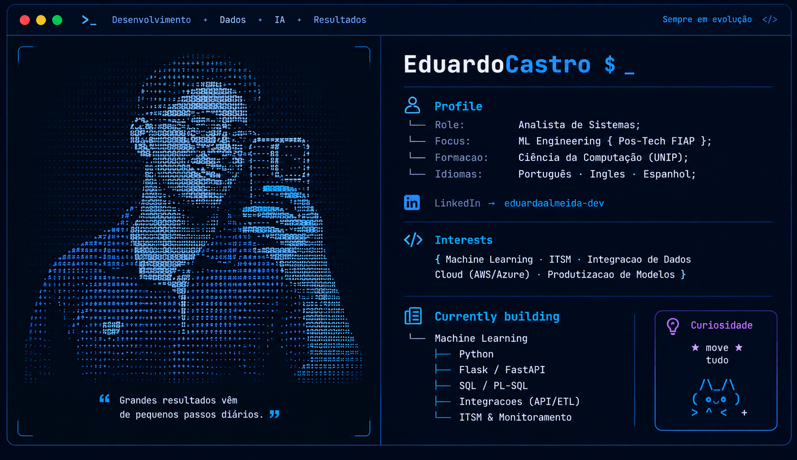

<!-- Perfil GitHub | Eduardo Castro de Almeida -->

  

  

<h1 align="center">Olá, eu sou Eduardo Castro 👋</h1>
<h3 align="center">Machine Learning Engineer em formação | Python • MLOps • Engenharia de Software</h3>

  
  
  
  
  

## 🎯 Sobre mim

Sou **profissional de tecnologia em transição para Machine Learning Engineering**, com experiência em **sistemas em produção, integração de dados, APIs e análise de incidentes**. Meu foco é construir soluções de ML que vão além do notebook: **pipelines reproduzíveis, experimentos rastreáveis, código testável e modelos preparados para integração com aplicações**.

- 🎓 Pós-graduando em **Machine Learning Engineering na FIAP Pós-Tech** (Fases 1 e 2 concluídas).
- 🧠 Experiência prática com **Scikit-learn, DVC, MLflow, Docker, FastAPI e testes automatizados** em projetos de ponta a ponta.
- ⚙️ Atuação profissional com **APIs, ETL, microsserviços, análise de causas-raiz e sustentação de ambientes críticos**.
- 🚀 **Fundador da TechLegacy**, onde desenvolvo soluções de software, automação e IA para pequenas e médias empresas.
- 🎯 **Objetivo profissional:** oportunidades como **Machine Learning Engineer Júnior**, com foco em MLOps, engenharia de dados para ML e produtização de modelos.

## 🧠 Projetos em destaque — Machine Learning Engineering

### 1. [Purchase Intention Prediction — Tech Challenge FIAP | Fase 2](https://github.com/eduardocastro-dev/Postech_Fase2-Purchase_Intent_Prediction)

**Problema:** prever a intenção de compra em um e-commerce a partir de sessões de navegação, priorizando **reprodutibilidade e rastreabilidade** do ciclo de ML.

**O que implementei no projeto:**
- Pipeline de dados organizado em **Bronze / Silver / Gold**, com validação e preparação dos dados.
- Comparação de modelos com **validação cruzada estratificada** e escolha criteriosa do limiar de decisão.
- **DVC** para versionamento dos dados, modelos e estágios do pipeline.
- **MLflow Tracking + Model Registry** para registrar experimentos, métricas, artefatos e versões de modelos.
- **Docker Compose**, **Poetry**, **Ruff** e **pytest** para padronização do ambiente e qualidade do código.
- Validação da **reprodução do pipeline a partir de um clone limpo** do repositório.

**Resultado em teste:** `F1 (classe compra): 0,6617` · `ROC-AUC: 0,9236` · `12.330 sessões analisadas`.

**Stack:** `Python` `Scikit-learn` `Pandas` `DVC` `MLflow` `Docker` `Poetry` `pytest`

[📂 Ver repositório e documentação](https://github.com/eduardocastro-dev/Postech_Fase2-Purchase_Intent_Prediction)

### 2. [Churn Prediction Challenge — Tech Challenge FIAP | Fase 1](https://github.com/eduardocastro-dev/Postech_Fase1-Churn_prediction_challenge)

**Problema:** identificar clientes com maior risco de cancelamento e disponibilizar as previsões para consumo por outros sistemas.

**O que implementei no projeto:**
- Análise exploratória, pré-processamento e comparação de classificadores.
- **Regressão Logística** com limiar de decisão ajustado para `0,40` conforme o objetivo de identificação de churn.
- **API REST com FastAPI**, modelo serializado, testes automatizados e conteinerização com **Docker**.
- Documentação técnica e publicação da API em ambiente de nuvem.

**Resultado em teste:** `F1: ~0,629` · `ROC-AUC: ~0,836` · `Recall: ~0,684`.

**Stack:** `Python` `Scikit-learn` `FastAPI` `Docker` `pytest` `REST API`

[📂 Repositório](https://github.com/eduardocastro-dev/Postech_Fase1-Churn_prediction_challenge) · [🔗 Documentação da API](https://churn-prediction-challenge.onrender.com/docs)

---

## 🏢 TechLegacy — Software, Automação e IA aplicada a negócios

Sou **fundador da TechLegacy**, iniciativa voltada ao desenvolvimento de **soluções digitais para pequenas e médias empresas**, com foco em problemas operacionais reais, integração de sistemas e uso prático de IA.

### 🚀 Produtos e projetos

| Produto / iniciativa | O que resolve | Situação |
| --- | --- | --- |
| **Plataforma de Agendamento** | Gestão de agendamentos e rotinas de prestadores de serviços, com backend e API próprios. | **MVP em operação com 2 clientes-piloto** |
| **LeadHunter** | Pesquisa e organização de potenciais clientes, mini-CRM, tratamento de dados comerciais e recursos de IA para apoiar a prospecção. | **MVP em desenvolvimento e validação** |
| **Automações e soluções de IA sob medida** | Integrações, automatização de tarefas repetitivas e aplicações de IA orientadas a processos de negócio. | **Frente de serviços da TechLegacy** |

**Destaques técnicos dos produtos:**

- **Agendamento:** `Python 3.11` `Flask` `SQLAlchemy` `Alembic` `JWT` `Flask-Limiter` `Gunicorn`.
- **LeadHunter:** integração com motor de coleta de empresas, tratamento e deduplicação de leads, exportação CSV, mini-CRM e funcionalidades com IA; **automações por WhatsApp e e-mail em evolução**.
- **Forma de trabalho:** levantamento da necessidade, desenho de APIs e fluxos, implementação, testes e evolução iterativa do produto.

> Construir produtos para pequenas empresas me ajuda a aplicar princípios de engenharia de software, qualidade de dados, automação e integração de IA em cenários próximos de produção.

📝 **Artigos, projetos e estudos:** [Blog da TechLegacy](https://blog.techlegacy.com.br/)

## 🛠️ Stack técnica

  

| Área | Ferramentas e conhecimentos |
| --- | --- |
| **Machine Learning** | Scikit-learn, Pandas, NumPy, classificação, validação cruzada, avaliação de modelos |
| **MLOps e reprodutibilidade** | MLflow, DVC, Docker, Docker Compose, versionamento e rastreabilidade |
| **Backend e integração** | Python, FastAPI, Flask, APIs REST, SQL, SQLAlchemy |
| **Qualidade e desenvolvimento** | pytest, Ruff, Git/GitHub, Poetry, Clean Code |
| **Em aprofundamento** | Kubernetes, Cloud, CI/CD e monitoramento de modelos |

## 💼 Experiência profissional

**TechLegacy — Fundador | ago/2026 – atual**  
Desenvolvimento de produtos próprios e soluções de automação para PMEs, envolvendo backend, APIs, integração de serviços e aplicações de IA.

**Digiage — Analista | ago/2025 – atual**  
Sustentação de ambientes de integração de dados, **APIs, ETL e microsserviços**; investigação de incidentes e análise de causas-raiz em sistemas produtivos, com atendimento orientado a SLA.

**GZ Sistemas — Analista de Sistemas / Suporte de TI / Trainee | mai/2022 – jul/2025**  
Evolução profissional do suporte à análise de sistemas; levantamento de requisitos, banco de dados, documentação, validação funcional e testes de QA. Atuação em **mais de 40 demandas** de um cliente com **42 lojas**.

## 🎓 Formação

- **Pós-graduação em Machine Learning Engineering** — FIAP Pós-Tech · Alura · PM3 (**2026–2027, em andamento**).  
  Fase 1: *Produtização de Modelos* ✅ · Fase 2: *Containers e Ambientes Reprodutíveis* ✅ · Próxima etapa: *Cloud e MLOps*.
- **Bacharelado em Ciência da Computação** — Universidade Paulista (UNIP) (**2022–2025**).
- **Técnico em Informática** — ETEC Rosa Perrone Scavone (**2016–2019**).

## ✍️ Compartilhando conhecimento

No [blog da TechLegacy](https://blog.techlegacy.com.br/) publico aprendizados sobre **engenharia de ML, Clean Code, modelos de churn, automação e aplicações práticas de IA**.

## 📊 Atividade no GitHub

  

---

  <b>Busco oportunidades para aplicar Machine Learning Engineering em produtos e sistemas reais.</b>
    
  <a href="https://www.linkedin.com/in/eduardoalmeida-dev/">LinkedIn</a> ·
  <a href="mailto:eduardocastro.technology@gmail.com">E-mail</a> ·
  <a href="https://blog.techlegacy.com.br/">Blog TechLegacy</a>

